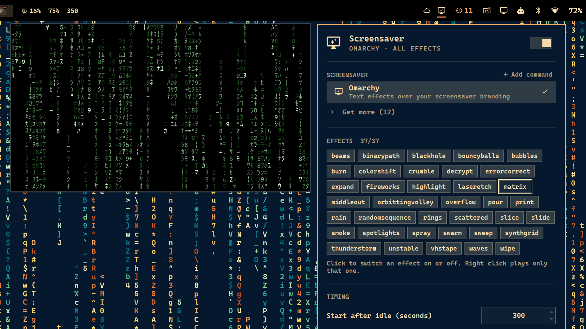

# Screensaver Manager for Omarchy

Choose the screensaver Omarchy starts when your computer goes idle. You can keep Omarchy's own screensaver and switch each of its text effects on or off, or use an installed terminal screensaver such as cmatrix, asciiquarium or pipes.sh. As you browse the list, a small live preview opens beside the panel.



## What it does

- **Choose a screensaver.** The choices are Omarchy's own, any known terminal screensaver you have installed, or any terminal command you add yourself.
- **Switch Omarchy's effects on and off.** Omarchy's screensaver picks a random [ttfx](https://github.com/omacom/ttfx) effect each round. Click an effect to take it out of the rotation or put it back. Right-click an effect to play only that one. Effects come from your installed ttfx, so new ones appear automatically.
- **Live previews.** Move the mouse or the keyboard cursor onto a screensaver or an effect, and a small preview window runs it beside the panel. The preview closes when you close the panel.
- **Timing.** Set how long the computer is idle before the screensaver starts, and the frame rate of Omarchy's effects.
- **Dismiss on mouse movement.** Omarchy's own screensaver only closes on a key press, or when it loses focus to another monitor. With this on (the default), moving the mouse or trackpad closes it too.
- **Install and remove screensavers.** *Get more* lists every known terminal screensaver, with a download button and a delete button side by side. Download opens a terminal with the install command, and delete opens one with `sudo pacman -Rns` for the package that owns the screensaver. Either way you confirm (or cancel) it in the terminal; the plugin never installs or removes anything itself.
- **Start now.** Starts the screensaver straight away. You can also right-click the bar icon.
- **Omarchy menu and a terminal command (optional).** One button adds the panel to the Omarchy menu, and another installs a `screensaver-manager` command. Both are off until you turn them on.

The bar icon is the monitor glyph Omarchy uses for its screensaver. It dims when the screensaver is turned off. The switch in the panel's header turns the screensaver on or off with Omarchy's own toggle.

### Known terminal screensavers

| Screensaver | Package | Licence |
|---|---|---|
| [cmatrix](https://github.com/abishekvashok/cmatrix) | `cmatrix` (extra) | GPL-3.0 |
| [unimatrix](https://github.com/will8211/unimatrix) | `unimatrix-git` (AUR) | GPL-3.0 |
| [neo](https://github.com/st3w/neo) | `neo-matrix` (AUR) | GPL-3.0 |
| [TMatrix](https://github.com/M4444/TMatrix) | `tmatrix` (AUR) | GPL-2.0 |
| [cxxmatrix](https://github.com/akinomyoga/cxxmatrix) | `cxxmatrix-git` (AUR) | MIT |
| [pipes.sh](https://github.com/pipeseroni/pipes.sh) | `pipes.sh` (AUR) | MIT |
| [pipes-rs](https://github.com/lhvy/pipes-rs) | `pipes-rs` (AUR) | BlueOak-1.0.0 |
| [asciiquarium](https://robobunny.com/projects/asciiquarium/) | `asciiquarium` (extra) | GPL-2.0-or-later |
| [cbonsai](https://gitlab.com/jallbrit/cbonsai) | `cbonsai` (AUR) | GPL-3.0 |
| [astroterm](https://github.com/da-luce/astroterm) | `astroterm` (extra) | MIT |
| [Nyan Cat](https://github.com/klange/nyancat) | `nyancat` (extra) | NCSA |
| [genact](https://github.com/svenstaro/genact) | `genact` (extra) | MIT |

None of them is needed. They're separate programs you can install if you want them. This plugin doesn't include any of their code. The list and each screensaver's command line are in [`catalog.json`](catalog.json). To use anything else, choose **Add command** in the panel.

## Requirements

Everything this plugin needs is already part of Omarchy:

- Omarchy with the Quickshell desktop shell (`omarchy-shell`), on a Hyprland with its Lua API (tested on Hyprland 0.56)
- `ttfx`, `jq`, `socat` and `xdg-terminal-exec`
- Alacritty, Ghostty, Foot or Kitty as your default terminal (the same requirement as Omarchy's own screensaver)

To test the plugin, you also need `node` (for `tests/model.test.js`).

## Installation

```bash
omarchy plugin add https://github.com/WhiskeyTangoFussell/omarchy-plugin-screensavermanager --enable
```

This puts the monitor icon on the right of your bar. Use `omarchy bar move` or the bar settings to move it. Click the icon to open the panel.

Plugins run as unsandboxed code inside your desktop shell, so read the code before enabling one. This plugin runs nothing at install time and never asks for `sudo`.

### Optional extras

The two buttons at the bottom right of the panel are:

- **Omarchy menu** (󰍜): adds *Style > Screensaver > Screensaver Manager*, which opens the panel. It also changes *System > Screensaver* so it starts your chosen screensaver instead of Omarchy's own. Both lines go in `~/.config/omarchy/extensions/omarchy-menu.jsonc`, between marker comments.
- **Terminal command** (󰆍): installs `~/.local/bin/screensaver-manager`, a two-line wrapper around `bin/screensaver-manager`.

## Using it from a terminal or a keybinding

```bash
screensaver-manager status              # what's selected, and how many effects are on
screensaver-manager list                # every screensaver, installed or not
screensaver-manager select cmatrix      # use cmatrix
screensaver-manager effects off burn    # take an effect out of the rotation
screensaver-manager effects only matrix # play only the matrix effect
screensaver-manager effects all         # every effect back on
screensaver-manager framerate 60
screensaver-manager mouse off           # only a key press dismisses it
screensaver-manager custom add "Clock" "tty-clock -c -C 4"
screensaver-manager launch              # start it now
screensaver-manager preview cmatrix     # small live preview (preview stop closes it)
screensaver-manager panel               # open the panel
```

If you haven't installed the wrapper, run `~/.config/omarchy/plugins/io.github.whiskeytangofussell.screensavermanager/bin/screensaver-manager` instead.

## How it works

Omarchy's idle service starts the screensaver by running `omarchy-launch-screensaver`. That launcher steps aside if a screensaver is already running. The plugin's service watches the idle service. When the idle service starts the screensaver and your setup isn't the stock one, the plugin runs its own launcher first. That launcher shows up in the stock launcher's check, so the stock launcher steps aside.

The plugin's screensaver windows use Omarchy's own window class (`org.omarchy.screensaver`), terminals and terminal configs. They go fullscreen on every monitor, and they close on a key press or when they lose focus. The idle service treats them as its own: the lock still follows at your lock timeout, and closing the screensaver still counts as activity.

To dismiss on mouse movement, the screensaver's terminal reports pointer movement as input, the same way a key press arrives. Tracking starts a second after the screensaver appears, so the pointer settling onto the new window doesn't close it.

If you choose Omarchy's screensaver with every effect on, the default 120 fps and mouse dismissal off, the plugin does nothing at idle and Omarchy's launcher runs as usual. If a screensaver you chose is uninstalled later, Omarchy's screensaver runs instead.

Changing the idle timeout normally needs a shell restart. Omarchy's idle service only updates its idle monitor's timeout, and Quickshell's idle monitor keeps the timeout it was started with until it's re-armed. While this plugin is enabled, its service re-arms the monitor whenever the timeout changes, whether from the panel, PowerCore or a hand edit of `shell.json`.

Omarchy's own toggle (*Trigger > Toggle > Screensaver*, or the switch in the panel) still turns the screensaver off completely. The plugin respects it, and it never starts a screensaver while the screen is locked.

### Where things are stored

| What | Where |
|---|---|
| Your choices (screensaver, effects that are off, frame rate, mouse dismissal, custom commands) | `~/.config/omarchy/screensaver-manager.json` |
| Idle timeout | `idle.screensaver` in `~/.config/omarchy/shell.json` (Omarchy's own setting) |
| On/off | `~/.local/state/omarchy/toggles/screensaver-off` (Omarchy's own toggle) |
| Text the effects draw | `~/.config/omarchy/branding/screensaver.txt` (edit it in *Style > Screensaver*) |

### Known limits

- If **PowerCore** is installed, it sets the idle timings for each power source, so the panel's timeout field is disabled and tells you to change the timings in PowerCore.
- *System > Screensaver* in the Omarchy menu still starts Omarchy's own screensaver unless you've added the menu entries.

## Removal

```bash
screensaver-manager menu remove    # only if you added the Omarchy menu entries
screensaver-manager cli remove     # only if you installed the command
omarchy plugin remove io.github.whiskeytangofussell.screensavermanager
rm -f ~/.config/omarchy/screensaver-manager.json
```

Once the plugin is removed, Omarchy's own screensaver runs at idle again exactly as before. The plugin never changes Omarchy's files.

## Development

```bash
node tests/model.test.js   # panel logic
bash tests/cli.test.sh     # the CLI, against a throwaway home directory
omarchy plugin validate .
```

After changing a QML file, run `omarchy-restart-shell` to see the change. The shell's automatic plugin reload can keep serving the previously compiled QML.

Plugin files live directly in the repo: `manifest.json`, `Service.qml` (idle takeover, state and actions), `Panel.qml` (bar icon and panel), `Model.js` (pure panel logic), `bin/screensaver-manager` (the CLI that does the work) and `catalog.json`.

## Licence

MIT. See [LICENSE](LICENSE). The fullscreen launcher and runner follow Omarchy's `omarchy-launch-screensaver` and `omarchy-screensaver`, which are also MIT licensed.
